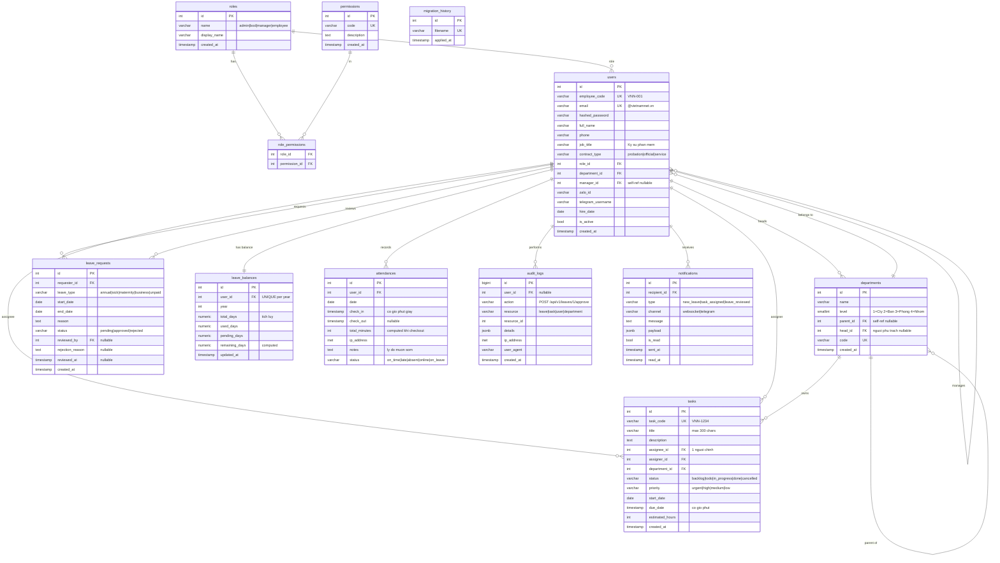

# ERD — Master Operation (Demo Version)

> **Phiên bản**: Demo RBAC — điều chỉnh từ PRD đầy đủ  
> **Nguyên tắc**: Đủ để chạy tất cả 9 RBAC scenarios, không over-engineer

---

## Phân tích Gap: PRD vs Demo

| Module | PRD (Full) | Demo (Giữ lại) | Demo (Bỏ qua — Phase sau) |
|--------|-----------|---------------|--------------------------|
| **Employee** | Avatar, CCCD, phone, job_title, contract_type, manager_id, hire_date, end_date, zalo_id, telegram_username, position_history | ✅ employee_code, job_title, contract_type, manager_id, hire_date, phone, zalo_id, telegram_username | ❌ Avatar (file storage), CCCD, end_date, position_history timeline |
| **Department** | Tên, người phụ trách, member_count, parent_id, loại (hành chính/dự án) | ✅ Tất cả trừ loại cấu trúc | ❌ struct_type (hành chính/dự án) |
| **Task** | Task code, multiple assignees (M2M), watchers, sprint, rich-text, custom fields, dependencies, tags, attachments, logged_hours, priority | ✅ task_code, priority, estimated_hours, assignee đơn (1 người) | ❌ Multiple assignees (M2M phức tạp), watchers, sprint, rich-text, dependencies, custom_fields |
| **Leave** | leave_type, attachment, rejection_reason, leave_balance per user | ✅ leave_type, rejection_reason, bảng leave_balances riêng | ❌ File attachment (cần storage) |
| **Attendance** | IP, device, total_hours, ghi chú | ✅ ip_address, total_minutes, notes | ❌ Device fingerprint |
| **CRM** | Contact, Account, Opportunity | ❌ Toàn bộ bỏ qua | Không liên quan RBAC demo |
| **Audit Log** | Who, What, When, IP, device | ✅ Đủ — thêm user_agent | ❌ Device fingerprint chi tiết |

---

## Lược đồ ERD (Demo — 12 entities)



---

## Giải thích các thay đổi so với ERD ban đầu

### Thêm vào `users` (từ PRD Employee Profile)

| Field | Kiểu | Lý do thêm |
|-------|------|-----------|
| `employee_code` | `VARCHAR UNIQUE` | Mã nhân viên VNN-001, yêu cầu PRD |
| `phone` | `VARCHAR` | Liên hệ nội bộ |
| `job_title` | `VARCHAR` | Hiển thị trong profile |
| `contract_type` | `VARCHAR` | probation/official/service — ảnh hưởng quyền |
| `manager_id` | `FK → users` | Self-ref: ai quản lý trực tiếp (dùng RBAC scope) |
| `zalo_id` | `VARCHAR` | Tích hợp thông báo sau |
| `telegram_username` | `VARCHAR` | Nhận Telegram notification |
| `hire_date` | `DATE` | Ngày vào công ty |

### Thêm vào `departments` (từ PRD Org Structure)

| Field | Kiểu | Lý do thêm |
|-------|------|-----------|
| `head_id` | `FK → users` | Người phụ trách phòng ban |

### Thêm vào `tasks` (từ PRD Task)

| Field | Kiểu | Lý do thêm |
|-------|------|-----------|
| `task_code` | `VARCHAR UNIQUE` | Định danh VNN-1234, yêu cầu PRD |
| `priority` | `VARCHAR` | urgent/high/medium/low |
| `start_date` | `DATE` | Ngày bắt đầu |
| `due_date` | `TIMESTAMP` | Có giờ phút theo PRD |
| `estimated_hours` | `INT` | Thời gian ước tính |
| `status` thêm | `backlog`, `cancelled` | Đủ trạng thái theo PRD |

### Thêm vào `leave_requests` (từ PRD Leave)

| Field | Kiểu | Lý do thêm |
|-------|------|-----------|
| `leave_type` | `VARCHAR` | annual/sick/maternity/business/unpaid |
| `rejection_reason` | `TEXT` | Lý do từ chối (nullable) |

### Bảng mới: `leave_balances` (từ PRD Leave Balance)

Theo dõi số ngày phép tích lũy / đã dùng / còn lại theo năm.

### Thêm vào `attendances` (từ PRD Attendance Log)

| Field | Kiểu | Lý do thêm |
|-------|------|-----------|
| `check_in` | `TIMESTAMP` | Đổi từ `TIMETZ` → có ngày giờ đầy đủ |
| `total_minutes` | `INT` | Tổng giờ làm tính được |
| `ip_address` | `INET` | Thiết bị/địa chỉ IP |
| `notes` | `TEXT` | Lý do muộn/sớm |

### Bảng mới: `notifications`

Lưu lịch sử thông báo đã gửi (Telegram + WebSocket), hỗ trợ query "thông báo chưa đọc".

---

## Những gì cố ý BỎ QUA trong demo

| Tính năng PRD | Lý do bỏ qua |
|--------------|-------------|
| **Avatar/ảnh đại diện** | Cần file storage (S3/MinIO) — phức tạp không liên quan RBAC |
| **CCCD** | Dữ liệu nhạy cảm, không cần cho RBAC demo |
| **Multiple assignees (M2M)** | Bảng `task_assignees` phức tạp query — demo 1 assignee là đủ |
| **Watchers** | Không ảnh hưởng RBAC logic |
| **Sprint** | Cần bảng `sprints` riêng — Phase sau |
| **Task dependencies** | Cần graph traversal — Phase sau |
| **Custom fields** | EAV pattern phức tạp — Phase sau |
| **Rich text + attachments** | Cần file storage — Phase sau |
| **Position history timeline** | Audit log đã cover một phần |
| **Performance metrics** | Tính toán phức tạp — Phase sau |
| **CRM (Contact/Account/Opportunity)** | Hoàn toàn ngoài scope RBAC demo |

---

## Cây tổ chức & Quan hệ manager_id

```
[Công ty] (level=1, parent_id=NULL)
├── [Ban A]             (level=2, parent_id=1)
│   ├── [Phòng X]          (level=3, parent_id=2)
│   └── [Phòng Y]          (level=3, parent_id=2)
└── [Ban B]             (level=2, parent_id=1)
    └── [Phòng Z]          (level=3, parent_id=5)
        └── [Nhóm]           (level=4, parent_id=6)
            ├── user_1 (manager_id → manager)
            └── user_2 (manager_id → manager)
```

> **Hai cơ chế scope song song**:
> - `department_id` + `DepartmentTreeService` → scope theo cây đơn vị
> - `manager_id` → scope theo người quản lý trực tiếp (dùng cho task assign)

---

## Indexes (cập nhật)

| Table | Index | Mục đích |
|-------|-------|---------|
| `departments` | `idx_dept_parent` | Tree traversal |
| `departments` | `idx_dept_head` | Tìm phòng theo người phụ trách |
| `users` | `idx_users_email` | Login |
| `users` | `idx_users_employee_code` | Tra cứu mã NV |
| `users` | `idx_users_department` | Scope filter |
| `users` | `idx_users_manager` | Direct report lookup |
| `tasks` | `idx_tasks_task_code` | Tra cứu VNN-xxxx |
| `tasks` | `idx_tasks_assignee` | Employee scope |
| `tasks` | `idx_tasks_department` | Manager scope |
| `tasks` | `idx_tasks_due_date` | Deadline filter |
| `leave_requests` | `idx_leave_requester` | Employee scope |
| `leave_requests` | `idx_leave_status` | Pending filter |
| `leave_balances` | `idx_balance_user_year` | UNIQUE(user_id, year) |
| `attendances` | `idx_attend_user_date` | UNIQUE(user_id, date) |
| `attendances` | `idx_attend_date` | Heatmap range query |
| `notifications` | `idx_notif_recipient_unread` | Unread count |
| `audit_logs` | `idx_audit_created DESC` | Recent logs |
